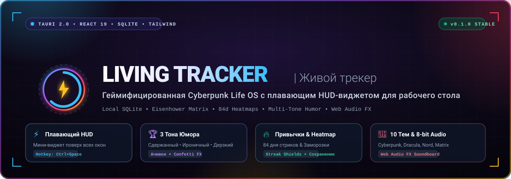
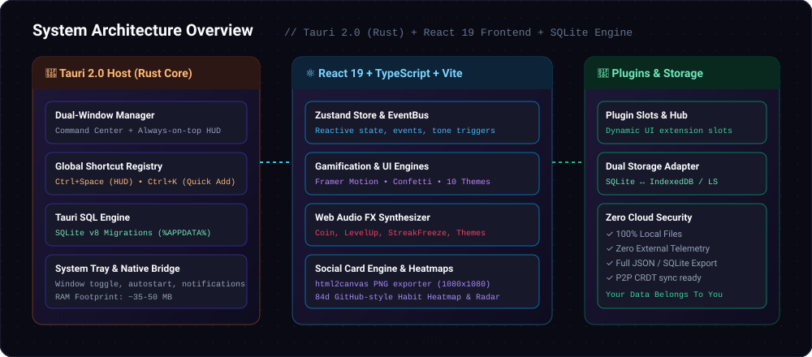

<p align="center">
  
</p>

<p align="center">
  <strong>Живой трекер (Living Tracker)</strong> — ультрабыстрый, геймифицированный личный командный центр и плавающий HUD-виджет для рабочего стола.<br />
  Построен на базе <strong>Tauri 2.0 (Rust)</strong>, <strong>React 19</strong>, <strong>TypeScript</strong>, <strong>Tailwind CSS</strong> и локального хранилища <strong>SQLite</strong>.
</p>

<p align="center">
  <a href="#-возможности-и-фичи"></a>
  <a href="#-стек-технологий"></a>
  <a href="#-стек-технологий"></a>
  <a href="#-быстрый-старт"></a>
  <a href="#-локальные-данные-и-безопасность"></a>
  <a href="#-10-киберпанк-тем-оформления"></a>
  <a href="LICENSE"></a>
</p>

<p align="center">
  <a href="#-особенности">Особенности</a> •
  <a href="#-горячие-клавиши">Горячие клавиши</a> •
  <a href="#-архитектура">Архитектура</a> •
  <a href="#-10-киберпанк-тем-оформления">Темы</a> •
  <a href="#-быстрый-старт">Быстрый старт</a> •
  <a href="#-структура-проекта">Структура</a> •
  <a href="#-дорожная-карта">Roadmap</a>
</p>

---

## 💡 О проекте

**Living Tracker** создавался как антидот к тяжелым, перегруженным и скучным трекерам привычек и задач. Это не просто список дел, а целая **персональная Cyberpunk Life OS**, которая живёт прямо у вас на рабочем столе, потребляет всего **~35–50 МБ RAM**, моментально вызывается по хоткею и превращает рутину в живую игру с юмором, звуками и сочными визуальными эффектами.

### ⚡ Сравнение с аналогами

| Параметр | Living Tracker | Обычные трекеры (Notion / Todoist) | Habitica |
| :--- | :---: | :---: | :---: |
| **Потребление RAM** | **~35–50 МБ** (Tauri + WebView2) | 300–800 МБ (Electron / Web) | 200–500 МБ |
| **Плавающий HUD-виджет** | **Да (`Ctrl+Space`, always-on-top)** | ❌ Нет (только тяжелое окно) | ❌ Нет |
| **Приватность & Хранение** | **100% Локальный SQLite** | Облако (риск утечек и подписок) | Облако |
| **Тональность обратной связи** | **3 тона (Сдержанный, Ирония, Дерзкий)** | Сухой формальный текст | Детское фэнтези |
| **Защита стриков (Streak Shields)**| **Да (экстренная заморозка при болезни)** | ❌ Сгорает весь стрик | Штраф здоровьем |
| **Генератор шеринг-карточек** | **Да (PNG 1080x1080 в клипборд)** | ❌ Нет | Скриншот экрана |
| **Звуковой движок** | **Встроенный Web Audio FX (8-bit)** | Без звука / стандартный динь | Простые сэмплы |

---

## 🚀 Возможности и фичи

### 1. ⚡ Двухоконная архитектура и плавающий HUD
- **Командный центр (1280x860):** Полноразмерный дашборд со всей аналитикой, матрицей Эйзенхауэра, кругом бюджета, тепловыми картами привычек, радаром баланса жизни и магазином плагинов.
- **Мини-виджет HUD (380x520):** Полупрозрачный, безрамочный, висит поверх всех окон (`alwaysOnTop`). Мгновенно появляется и исчезает по глобальной комбинации `Ctrl+Space` или клику по иконке в трее. Позволяет отмечать задачи и привычки, не отвлекаясь от работы или игры.

### 2. 🎭 Динамический эмоциональный интеллект (3 тона)
Каждое достижение, уведомление и похвала генерируются в одном из трёх переключаемых режимов:
- **Neutral (Сдержанный):** Классический лаконичный стиль для работы и фокуса.
- **Ironic (Ироничный):** Тонкий сарказм над вашей продуктивностью и прокрастинацией.
- **Sassy (Дерзкий):** Неформальный юмор без цензуры и с крепким словом для максимального заряда бодрости.

### 3. 🔥 Привычки, 84-дневные Heatmaps & Заморозка стриков
- **GitHub-style Heatmaps:** Интерактивные тепловые карты активности с историей на 28, 56 и 84 дня.
- **Emergency Streak Freeze (Заморозка):** Заработанные щиты позволяют заморозить стрик, если вы заболели, уехали или взяли заслуженный выходной. Прогресс не обнулится!
- **Категории и таргетинг:** Гибкая настройка частоты (ежедневно, X раз в неделю, будни/выходные).
- **Экспорт матрицы привычек:** Генерация стильной карточки прогресса в высоком разрешении для социальных сетей или отчёта себе.

### 4. 🎯 Умные задачи & Матрица Эйзенхауэра
- **2x2 Eisenhower Matrix:** Разделение задач по квадрантам: *Срочно & Важно*, *Важно*, *Срочно*, *Рутина*.
- **Умная сортировка срочности:** Алгоритм автоматически поднимает наверх задачи с горящими дедлайнами.
- **Чеклисты подзадач:** Дробление крупных целей на быстрые подшаги с прогресс-баром.
- **Быстрый Snooze (+1d / +3d):** Перенос сроков в один клик без ручного ввода дат.
- **Закрепление задач (Pinning):** Фиксация критически важных задач в топе списка.

### 5. 🍩 Интерактивное кольцо бюджета
- Анимированное круговое кольцо расходов на базе `framer-motion` с физикой наполнения.
- Быстрый ввод расхода прямо из HUD-виджета за пару секунд.
- Категоризация трат и наглядный контроль лимита бюджета.

### 6. 🕸️ Радар баланса жизни (Life Balance Radar)
- Паутинная диаграмма по 6 ключевым сферам: *Здоровье*, *Карьера/Код*, *Интеллект*, *Финансы*, *Отношения*, *Отдых*.
- Мгновенный шеринг карточки баланса через `html2canvas`.

### 7. ⏱️ Pomodoro Focus Timer
- Встроенный таймер продуктивности с интервалами работы и отдыха.
- Звуковые оповещения старта и завершения интервалов.
- Прямая интеграция с выполнением текущих задач.

### 8. 🔊 Web Audio FX Саундборд
- Полностью процедурные, синтезированные на лету звуки без загрузки тяжёлых внешних аудиофайлов:
  - Звон монет за выполнение задач (`Coin FX`).
  - Фанфары получения ачивки (`Level Up`).
  - Активация ледяного щита стрика (`Streak Freeze FX`).
  - Звук шеринга карточки и клика по темам.
- Мастер-слайдер громкости и мгновенный Mute в один клик.

### 9. 🐱 Кот-компаньон (Cat Clicker Easter Egg)
- Интерактивный виртуальный кот-компаньон в нижнем углу экрана.
- Мурлыкание, анимации клика и скрытые ачивки для любителей покликать во время раздумий.

### 10. 🔌 Расширяемая плагинная экосистема
- **UI Slots:** Точки расширения интерфейса (`dashboard.widgets`, `sidebar.nav`, `task.actions`).
- **Event Bus:** Шина событий `eventBus.emit(event)` / `eventBus.on(event, handler)`, связывающая действия пользователя с ачивками и сторонними модулями.
- **Встроенный маркетплейс плагинов:** Включение и отключение дополнений в реальном времени.

---

## ⌨️ Горячие клавиши

| Хоткей | Действие | Контекст |
| :--- | :--- | :--- |
| <kbd>Ctrl</kbd> + <kbd>Space</kbd> | **Открыть / скрыть плавающий HUD** | Глобально в Windows / системе |
| <kbd>Ctrl</kbd> + <kbd>K</kbd> | **Быстрое добавление (Quick Add Modal)** | Внутри приложения |
| <kbd>Esc</kbd> | **Закрыть активное модальное окно** | Везде |
| <kbd>Tab</kbd> / <kbd>Shift+Tab</kbd> | Навигация по полям ввода | В формах |

---

## 🏗️ Архитектура

Приложение спроектировано по принципу **Local-First & Zero-Cloud**: все ваши мысли, финансы и привычки хранятся исключительно на вашей машине в файле SQLite. Никаких внешних серверов, телеметрии или привязки к аккаунтам.

<p align="center">
  
</p>

### Технологический стек

```
┌────────────────────────────────────────────────────────┐
│                   Desktop Native Host                  │
│       Tauri 2.0 (Rust) • RAM ~35-50MB • Windows/Linux  │
│  - SQLite Plugin (Migrations v1..v8)                   │
│  - Global Shortcuts (Ctrl+Space HUD / Ctrl+K)          │
│  - System Tray + Native Window Management              │
└───────────────────────────┬────────────────────────────┘
                            │ IPC Bridge
┌───────────────────────────▼────────────────────────────┐
│                    Frontend Runtime                    │
│             React 19 • TypeScript • Vite               │
│  - State & Events: Zustand 5 + Decoupled EventBus      │
│  - Styling & Layout: Tailwind CSS + Cyberpunk CSS Vars │
│  - Animations: Framer Motion 12 + Canvas Confetti      │
│  - Audio: Synthesized Web Audio API FX Engine          │
│  - Export: html2canvas HD Social Card Render Engine    │
│  - Storage Adapter: Tauri SQL ↔ IndexedDB Fallback    │
└────────────────────────────────────────────────────────┘
```

---

## 🎨 10 Киберпанк Тем Оформления

Переключение тем происходит мгновенно с приятным звуковым сопровождением и плавной сменой CSS-переменных:

| Тема | Превью | Стиль и Акценты | Hex Палитра |
| :--- | :---: | :--- | :--- |
| **AMOLED** | 🌌 | Глубокий полночный черный с неоновым цианом | `#090d16` / `#38bdf8` |
| **Cyberpunk** | ⚡ | Неоновый ночной Найт-Сити: фиолетовый & электрик-жёлтый | `#120726` / `#facc15` |
| **Emerald** | 🍃 | Глубокий изумруд с золотыми акцентами | `#061a14` / `#fbbf24` |
| **Synthwave** | 🌆 | Ретровейв 80-х: неоновый закат, фуксия и розовая лава | `#180a28` / `#f43f5e` |
| **Nordic** | ❄️ | Арктический холод: ледяной циан и сумеречный сланец | `#0f172a` / `#38bdf8` |
| **Dracula** | 🧛 | Классический готический стиль: вампирский фиолетовый | `#1a1a24` / `#bd93f9` |
| **Tokyo Night** | 🗼 | Сумерки Сибуи: индиго и неоновые вывески | `#1a1b26` / `#7aa2f7` |
| **Crimson** | 🩸 | Бархатное вино и неоновый алый рубин | `#150810` / `#f43f5e` |
| **Matrix** | 💻 | Цифровой дождь: терминальный хакерский зелёный | `#0b1a0e` / `#22c55e` |
| **Sunset** | 🌅 | Тёплый градиент закатного янтаря и терракоты | `#180d0d` / `#f59e0b` |

---

## 🛠️ Быстрый старт

### Требования
- **Node.js:** `v20.x` или новее
- **npm:** `v10.x` или новее
- *(Для сборки десктопного .exe/.msi)* **Rust & Cargo:** `v1.78+` и системные зависимости Tauri 2.0 ([Tauri Prerequisites Guide](https://v2.tauri.app/start/prerequisites/))

### 1. Клонирование репозитория
```bash
git clone https://github.com/00DaEdRa00/living-tracker.git
cd living-tracker
```

### 2. Установка зависимостей
```bash
npm install
```

### 3. Запуск веб-версии (быстрая разработка в браузере)
```bash
npm run dev
```
Приложение откроется по адресу `http://localhost:5173`. В режиме браузера автоматически включится `IndexedDB/LocalStorage` слой вместо нативного SQLite.

### 4. Запуск десктопной версии (Tauri 2.0 HUD + Main)
```bash
npm run tauri dev
```

### 5. Запуск тестов
Проект покрыт всесторонним набором юнит- и интеграционных тестов:
```bash
npm test
```
```
✓ 18 test files passed (18)
✓ 128 tests passed (128)
```

### 6. Сборка продакшн-релиза
```bash
# Сборка фронтенда
npm run build

# Сборка нативного легковесного инсталлятора
npm run tauri build
```
Готовый бинарник будет находиться в каталоге `src-tauri/target/release/bundle/`.

---

## 📂 Структура проекта

```
living-tracker/
├── assets/                 # Векторная графика, SVG баннеры и диаграммы архитектуры
│   ├── banner.svg          # Главный баннер репозитория
│   └── architecture.svg    # Интерактивная архитектурная схема
├── src/                    # Фронтенд-приложение (React 19 + TypeScript)
│   ├── components/         # Модульные компоненты интерфейса
│   │   ├── AchievementsGalleryModal.tsx # Галерея и генерация ачивок
│   │   ├── BudgetRing.tsx               # Интерактивное кольцо бюджета
│   │   ├── CatClicker.tsx               # Интерактивный кот-компаньон
│   │   ├── DailySummaryShareModal.tsx   # Шеринг сводки дня
│   │   ├── HabitMatrixShareModal.tsx    # Шеринг матрицы привычек
│   │   ├── HabitsSection.tsx            # Трекер привычек + 84d Heatmap
│   │   ├── HudWidget.tsx                # Плавающее окно HUD (alwaysOnTop)
│   │   ├── LifeBalanceRadar.tsx         # Радар 6 сфер жизни
│   │   ├── PluginMarketplace.tsx        # Маркетплейс дополнений
│   │   ├── QuickAddModal.tsx            # Модалка быстрого добавления (Ctrl+K)
│   │   ├── SoundEffectsModal.tsx        # Саундборд и микшер эффектов
│   │   ├── TasksSection.tsx             # Задачи, матрица Эйзенхауэра
│   │   ├── ThemeSelector.tsx            # 10 киберпанк-тем оформления
│   │   └── ToneToggle.tsx               # Переключатель тонов юмора
│   ├── lib/                # Вспомогательные библиотеки
│   │   ├── soundFx.ts      # Web Audio API процедурный генератор звука
│   │   ├── tauriBridge.ts  # Безопасный мост между Tauri и веб-рантаймом
│   │   └── storageRepo.ts  # Абстракция базы данных (SQLite ↔ IndexedDB)
│   ├── plugins/            # Встроенные и пользовательские плагины
│   ├── store/              # Zustand стейт-менеджер и EventBus
│   └── types/              # Строгая типизация TypeScript
├── src-tauri/              # Нативный бекенд Tauri 2.0 (Rust)
│   ├── src/                # Точка входа Rust, управление окнами, трей
│   ├── capabilities/       # Разрешения безопасности Tauri 2.0
│   └── tauri.conf.json     # Конфигурация двух окон, трея и плагинов
├── .github/                # CI/CD Workflows, issue & PR шаблоны
└── TECH_SPEC.md            # Техническая спецификация проекта
```

---

## 🗺️ Дорожная карта (Roadmap)

- [x] **Sprint 1:** Базовая архитектура Tauri 2.0 + React 19 + SQLite слой.
- [x] **Sprint 2:** Плавающий HUD виджет с хоткеем `Ctrl+Space` и треем.
- [x] **Sprint 3:** 84-дневные тепловые карты, Streak Freeze щиты и генератор шеринг-карточек.
- [x] **Sprint 4:** Матрица Эйзенхауэра 2x2, Pomodoro таймер, Web Audio FX и 10 тем.
- [ ] **Sprint 5 (В планах):** P2P синхронизация через `Yjs` + `WebRTC` между своими устройствами без центрального сервера.
- [ ] **Sprint 6 (В планах):** Локальный AI-ассистент анализа привычек (Ollama / Local LLM без передачи данных наружу).
- [ ] **Sprint 7 (В планах):** Мобильный клиент для Android и iOS (Tauri Mobile 2.0).

---

## 🤝 Участие в разработке (Contributing)

Мы горячо приветствуем вклад сообщества! Если у вас есть идея новой темы, звукового эффекта, плагина или улучшения производительности:

1. Ознакомьтесь с [CONTRIBUTING.md](CONTRIBUTING.md).
2. Сделайте Fork репозитория.
3. Создайте ветку для вашей фичи: `git checkout -b feat/amazing-feature`.
4. Запустите тесты и убедитесь, что всё зелёное: `npm test`.
5. Создайте Pull Request — мы оперативно его рассмотрим!

---

## 📄 Лицензия

Проект распространяется под открытой и свободной лицензией **MIT License**. Подробнее см. в файле [LICENSE](LICENSE).

<p align="center">
  Сделано с ❤️ для тех, кто ценит эстетику, продуктивность и контроль над своими данными.
</p>
